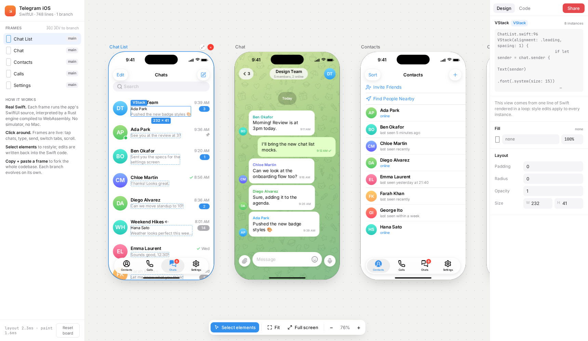
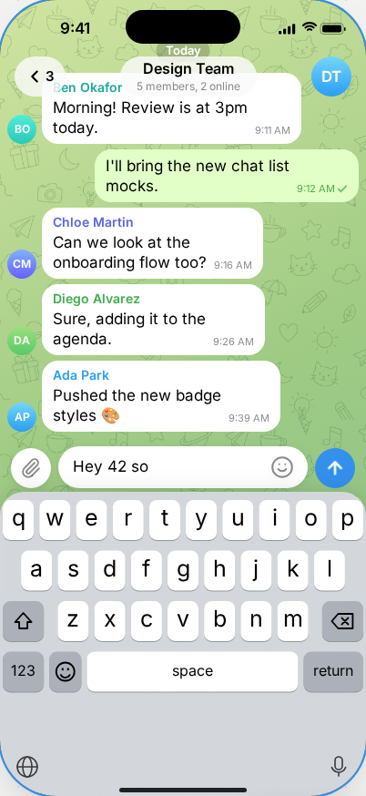
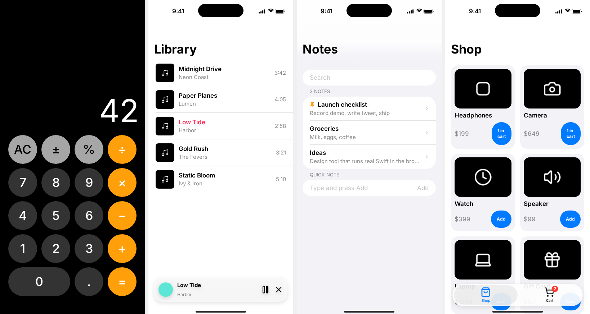
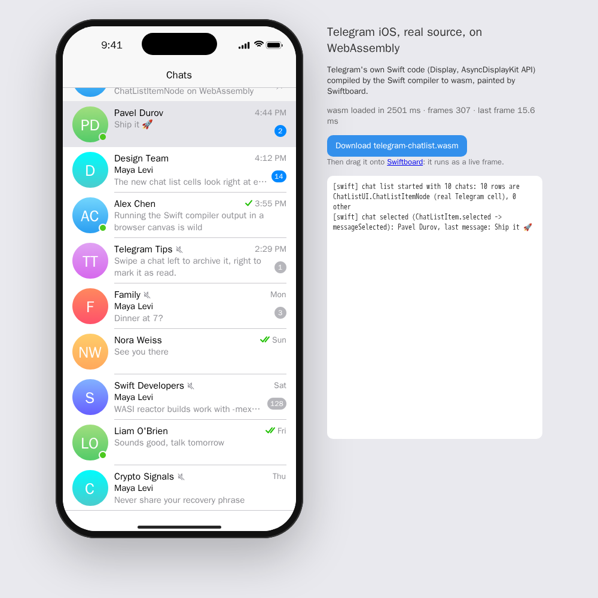

<div align="center">

# Swiftboard

### iOS for the web: real Swift apps, running live in your browser, on a design board you can branch.

No simulator. No Mac. No Xcode builds.

[**Live demo →**](https://swiftboard.spiritt.app/) &nbsp;·&nbsp; [Examples](#examples) &nbsp;·&nbsp; [How it works](#how-it-works) &nbsp;·&nbsp; [Help wanted](#help-wanted)

<a href="https://spiritt.ai/go/workspaces?ref=github-swiftboard&v=agents&p=Deploy+Swiftboard+for+me%3A+clone+https%3A%2F%2Fgithub.com%2Ftamir-spiritt%2Fswiftboard%2C+follow+its+AGENTS.md+%28build+the+Rust+engine+to+WebAssembly+with+tools%2Fbuild.sh%2C+then+publish+the+dist%2F+folder+as+a+static+site+with+spiritt+deploy%29+and+send+me+the+live+link+once+it+loads."></a>



</div>

---

## Built by SPIRITT, in one mission

**Swiftboard was created end to end by [SPIRITT](https://spiritt.ai/?utm_source=github&utm_medium=readme&utm_campaign=swiftboard), the world's best coding agent and an autonomous workforce that can run for hours or weeks on a mission without losing context. Just like this project.**

One prompt ("reproduce this") became a Swift interpreter, a SwiftUI layout engine, a canvas renderer, a design board, an iOS
keyboard, seven example apps, a test suite, and a port of Telegram's real iOS source to WebAssembly. SPIRITT researched,
wrote, tested in a real browser, fixed what it found, deployed, and kept going, all in the same running mission.

**[Start your own mission on SPIRITT →](https://spiritt.ai/go/workspaces?ref=github-swiftboard-readme&v=agents)**

---

## What it does

- **Real SwiftUI, live.** Drop a folder of `.swift` files on the board. Every `#Preview` becomes an interactive phone
  frame: tap, type, scroll, navigate, switch tabs. State (`@State`, `@Binding`) behaves like on device.
- **A real iOS keyboard.** Focus a text field and the keyboard slides up, the layout moves above it, and keys type,
  shift, switch to 123 and submit.
- **Design on top of code.** Select any element to see its exact size and source line, then change font, colour,
  padding, radius or size. Every edit is written back into the Swift source as a modifier.
- **Branch the whole codebase.** Copy and paste a frame (⌘C ⌘V) to fork every file into a new branch. Each frame
  evolves on its own, with version history and one-click restore.
- **Fast.** Most edits recompile and redraw in about 10 ms. A screen lays out in 1 to 3 ms.
- **Runs anywhere.** One static site: a ~700 KB WebAssembly engine plus plain JavaScript. Nothing to install.

<p align="center"></p>

## Examples

Click any of these in the sidebar of the [live demo](https://swiftboard.spiritt.app/), or open the folders in
[`examples/`](examples):

| App | What to try |
|---|---|
| Messenger | Telegram-style chat app: 5 screens, open a chat, type, send, switch tabs |
| Weather | Gradient screen, tap "Show °F" |
| Todo | Counter, toggle, filters, add a todo |
| Calculator | A working iOS calculator: 7 × 6 = |
| Music Player | Tap a song, a mini player appears |
| Notes | Search, open a note, quick add |
| Shop | Product grid, add to cart, cart badge and totals |



## How it works

```
 .swift files ──► lexer/parser ──► interpreter ──► SwiftUI layout ──► display list ──► Canvas 2D
                  (Rust)           (@State,        (propose/size/      (JSON ops)       (browser)
                                    closures,       place, stacks,
                                    enums...)       lists, nav, tabs)
                          └──────────── compiled to WebAssembly, zero dependencies ────────────┘
```

- `engine/` (Rust): Swift lexer, parser and tree-walking interpreter; a SwiftUI layout engine (stacks, spacers,
  frames, lists, forms, navigation stacks, iOS 26 floating tab bar, safe areas, scroll views); a display-list renderer.
  State lives outside the view tree, keyed by view identity, so it survives edits and re-renders.
- `web/`: the board (infinite canvas, frames, inspector, code editor, branches), the Canvas 2D painter, the
  keyboard, and SF Symbol names mapped to [Lucide](https://lucide.dev) icons.
- `examples/`: plain SwiftUI apps, valid Xcode code, no special dialect.

### Real UIKit apps: Telegram's own source, on WebAssembly (in progress)

SwiftUI runs through Swiftboard's own interpreter. For big UIKit codebases we take the other road: **the real Swift
compiler** (Swift 6.4 + the official WebAssembly SDK) compiles the app as is, against browser implementations of
Apple's frameworks in [`platform/`](platform): UIKit, QuartzCore, CoreGraphics, CoreText, AsyncDisplayKit and Dispatch.
The test app is [Telegram for iOS](https://github.com/TelegramMessenger/Telegram-iOS), downloaded at build time from
its own repository.

<p align="center"></p>

Running today, compiled from Telegram's real source:
- `SwiftSignalKit` (Telegram's reactive core) and `Display` (its UI framework, ~80k lines), with **zero source changes
  beyond two one-line patches**
- Telegram's `ListView`, theme, unread badges, online markers and English strings, in a 10-chat list you can scroll and tap

Next: the chat rows themselves. The rows on screen follow Telegram's measurements but are written by us; Telegram's
`ChatListItemNode` is the next module to compile (it needs a fake data layer for TelegramCore and Postbox).

**Try it:** open the [live chat list](https://swiftboard-telegram-vyzwy.spiritt.app/), or download
`telegram-chatlist.wasm` there and drag it onto [Swiftboard](https://swiftboard.spiritt.app/): compiled UIKit apps run
as live frames next to SwiftUI ones. Build it yourself with [`demos/telegram/`](demos/telegram/PORTING.md).

## Quick start

```bash
rustup target add wasm32-unknown-unknown
./tools/build.sh                       # builds the engine and the site into dist/
python3 -m http.server -d dist 8080    # open http://localhost:8080
```

Tests: `cd engine && cargo test` renders every example and drives taps, typing and navigation.
Render one screen from the CLI: `cargo run --example render ../examples/04-Calculator Calculator`.

Deploying on SPIRITT? Click **Deploy on SPIRITT** above: your workspace agent follows [`AGENTS.md`](AGENTS.md).

## Help wanted

Swiftboard is young and there is a lot of SwiftUI left to cover. Pick anything below, open an issue to say you are on
it, and send a PR with an example app that exercises it. Items marked **good first issue** are small and self-contained.

### SwiftUI coverage (engine)
- [ ] `@Observable`, `ObservableObject` / `@Published`, `@StateObject`, `@EnvironmentObject`: class instances with reference semantics (the biggest gap for real apps)
- [ ] Animations and transitions: `withAnimation`, `.animation`, `.transition`, `matchedGeometryEffect` (today changes apply instantly)
- [ ] Presentation: `.sheet`, `.fullScreenCover`, `.alert`, `.confirmationDialog`, `.popover` (parsed, not shown yet)
- [ ] `.contextMenu`, `.swipeActions`, `.searchable`, `.refreshable`
- [ ] Controls: `Slider`, `Stepper`, `DatePicker`, working `Picker` and `Menu` (today they render as buttons) **good first issue**
- [ ] Shapes: `Path`, custom `Shape` conformances, `.trim`, arcs, dashed `StrokeStyle`
- [ ] Layout: real `GeometryReader` sizes, `ViewThatFits`, `Grid`/`GridRow`, `LazyHGrid`, `.layoutPriority` edge cases, `.alignmentGuide`
- [ ] Gestures: `DragGesture`, `LongPressGesture`, `MagnifyGesture`
- [ ] Text: `AttributedString`, Markdown in `Text`, styled `Text` concatenation, `.lineSpacing` **good first issue**
- [ ] Images: asset catalogs (`Assets.xcassets`), `AsyncImage`
- [ ] Language: generics with constraints, protocols with associated types, `async`/`await`, `Codable`, `defer`
- [ ] Full dark mode pass over all semantic colours and materials **good first issue**
- [ ] Dynamic Type sizes and accessibility labels

### Board
- [ ] "Ask for a change": type an instruction, get a Swift edit on the selected branch
- [ ] Share a branch by link; export a branch as an Xcode project
- [ ] Undo/redo for inspector edits **good first issue**
- [ ] Editor: autocomplete, go to definition, inline errors
- [ ] iPad and landscape devices **good first issue**
- [ ] Animated frame transitions (push/pop, tab switch, sheet)

### Real UIKit apps (`platform/`, Telegram port)
- [ ] UIKit / QuartzCore / CoreGraphics / CoreText coverage beyond what Telegram's UI layer needs
- [ ] Build service: drop a UIKit project on the board, compile it to WebAssembly in the cloud, load it in a frame
- [ ] Objective-C for mixed codebases (clang to WebAssembly plus a runtime such as libobjc2)
- [ ] Threads (`wasip1-threads` with cross-origin isolation) instead of the single-threaded run loop
- [ ] Binary size: Foundation pulls in ICU; slim it with FoundationEssentials, `-Osize` and `wasm-opt`
- [ ] Telegram: compile `ChatListItemNode` against a fake TelegramCore/Postbox, then the chat screen and the input bar

See [CONTRIBUTING.md](CONTRIBUTING.md) for the dev loop.

## Credits

- Inspired by [@eminimnim](https://x.com/eminimnim/status/2122350451655864466) and the dessn.ai team's "iOS for the web" demo.
- Icons: [Lucide](https://lucide.dev) (ISC). SF Symbols names are mapped to Lucide paths at build time.
- Telegram is a trademark of its owners; Swiftboard is not affiliated with Telegram. The Messenger example is an
  original SwiftUI app in a familiar chat style.

## License

[MIT](LICENSE) for Swiftboard. Telegram's source is GPL and is never committed here: the port downloads it at build
time, and the few patched Telegram files in `demos/telegram/overlay/` stay under Telegram's GPL.

<div align="center"><sub>Built using <a href="https://spiritt.ai/?utm_source=github&utm_medium=readme&utm_campaign=swiftboard">SPIRITT</a></sub></div>
